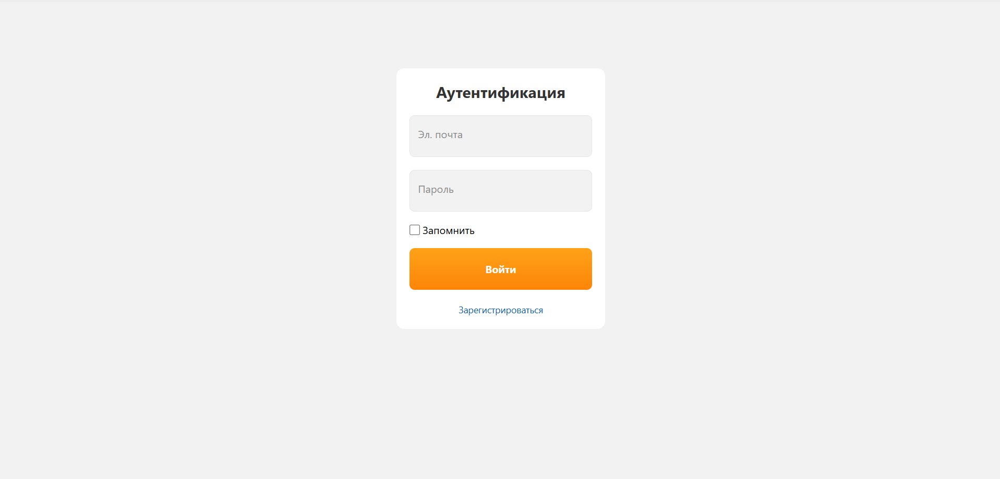
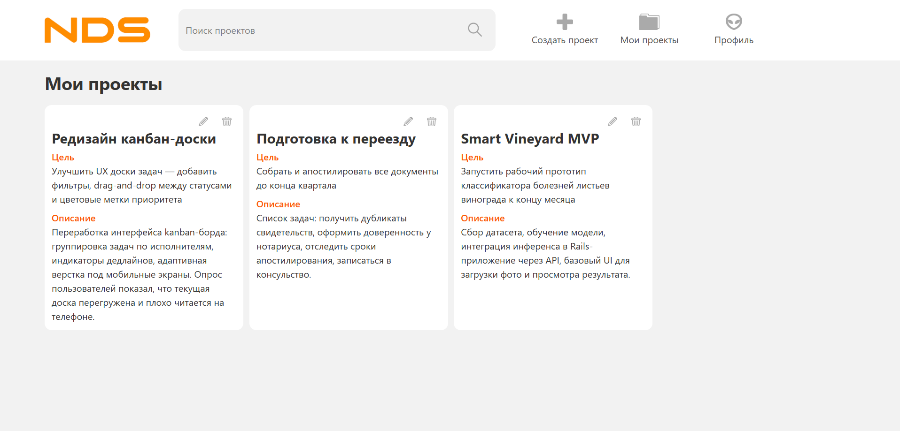
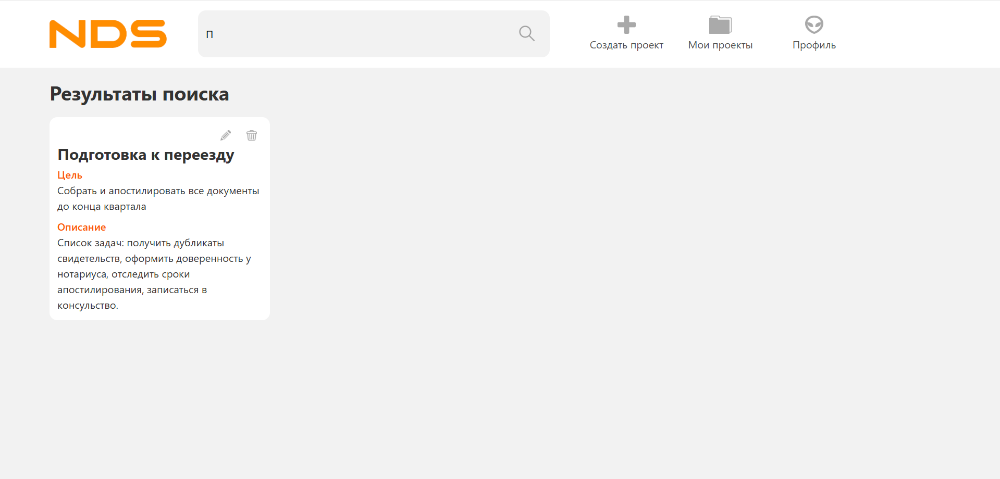
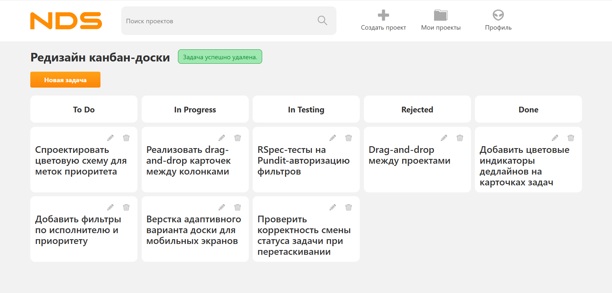

# Useful Practice

A web application for managing projects and tasks. Each user maintains their own projects with a kanban board of tasks organized by status.

## Stack

- **Ruby on Rails 8.1**
- **PostgreSQL**
- **Tailwind CSS 4**
- **Devise** — authentication
- **Pundit** — authorization
- **state_machines** — task status management
- **Hotwire (Turbo + Stimulus)**

## Features

- Sign up and sign in (Devise)
- Project CRUD — each project has a name, goal, and description
- Task CRUD within a project
- Kanban board with task statuses: **To Do → In Progress → In Testing → Done / Rejected**
- Project search by name
- Authorization via Pundit — users can only see and manage their own data

## Local Setup

**Requirements:** Ruby 3.3.12, PostgreSQL

```bash
git clone <repo>
cd useful_practice
```

Create a `.env` file in the project root:

```
DB_HOST=localhost
DB_USERNAME=your_postgres_username
DB_PASSWORD=your_postgres_password
```

```bash
bundle install

bin/rails db:create db:migrate

bin/dev
```

The app will be available at `http://localhost:3000`.

## Screenshots

**Authentication**


**My Projects**


**Project Search**


**Kanban Board**


## Tests

```bash
bundle exec rspec
```

**Stack:** RSpec + FactoryBot. 102 examples total.

### Model specs (`spec/models/`)

**`task_spec.rb`**
- Validations: valid creation, blank name is invalid, name must be unique within a project, same name is allowed across different projects
- Associations: `belongs_to :project`
- State machine — all 6 transitions tested individually:
  - `ToDo → InProgress` (inprogress)
  - `InProgress → InTesting` (intesting)
  - `InProgress → ToDo` (todo)
  - `InTesting → Done` (done)
  - `InTesting → Rejected` (rejected)
  - `Rejected → InProgress` (inprogress)

**`project_spec.rb`**
- Validations: valid creation, blank name is invalid, name must be unique per user, same name is allowed for different users
- Associations: `belongs_to :user`; `dependent: :destroy` removes tasks when project is destroyed
- `#tasks_by_state`: returns `[]` for a project with no tasks; interleaves tasks by kanban column; inserts `nil` for empty columns so the grid stays rectangular

**`user_spec.rb`**
- Validations: email required, email must be unique, password required
- Associations: `dependent: :destroy` removes projects when user is destroyed

### Request specs (`spec/requests/`)

Requests go through the full stack (routing, middleware, Devise, real view rendering). Each action is tested against three scenarios:
1. Resource does not exist → 404 page
2. Resource belongs to another user → `redirect_to root_path` with an alert (Pundit)
3. Resource belongs to current user → normal behavior

**`projects_spec.rb`** — all 7 routes:
- `GET /projects` — redirects when not signed in; shows only current user's projects; filters by name search query
- `GET /projects/new` — redirects when not signed in; renders form when signed in
- `POST /projects` — blank or duplicate name re-renders the form with 422; valid params create the project and redirect
- `GET /projects/:id` — shows the project with its tasks or an empty state; authorization checks
- `GET /projects/:id/edit` — renders the form with current values; authorization checks
- `PATCH /projects/:id` — updates the record; blank name re-renders the form with 422
- `DELETE /projects/:id` — deletes own project; does not delete another user's project

**`tasks_spec.rb`** — all 5 routes (no `show`):
- Project lookup uses `policy_scope`, so a foreign project returns 404 (not a redirect)
- `POST` — blank name re-renders the form with 422; valid params create the task
- `PATCH` — name and state updated separately in assertions; invalid state re-renders the form with an error and does not save the new name
- `DELETE` — deletes the task; returns 404 for non-existent task

**`users_spec.rb`**
- `GET /users` — redirects when not signed in; renders the profile page when signed in

### Policy specs (`spec/policies/`)

**`project_policy_spec.rb`**
- `index?` / `create?` — always allowed for any authenticated user
- `show?` / `edit?` / `update?` / `destroy?` — allowed for the owner, denied for a non-owner
- `Scope#resolve` — returns only projects belonging to the current user

**`task_policy_spec.rb`**
- All four actions (`show?`, `create?`, `update?`, `destroy?`) — allowed when the current user owns the task's project, denied otherwise

**`user_policy_spec.rb`**
- `index?` — always allowed for any authenticated user

