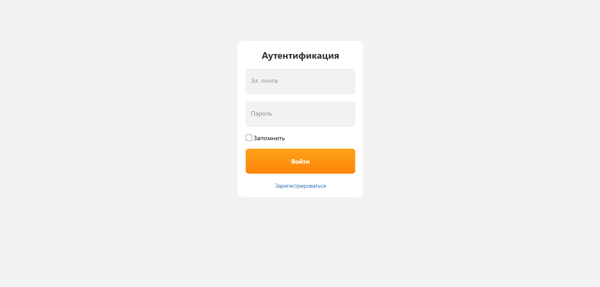
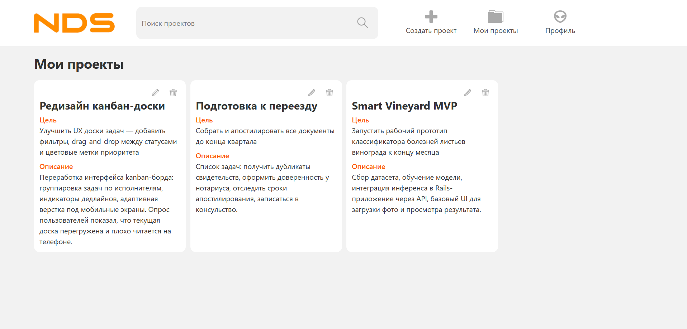
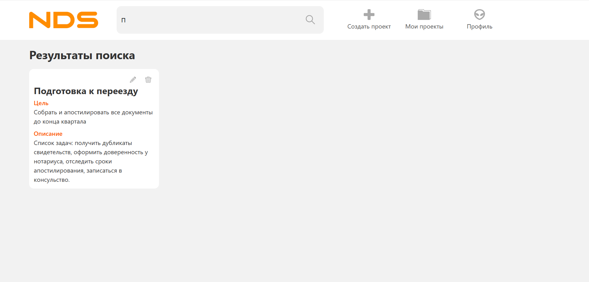
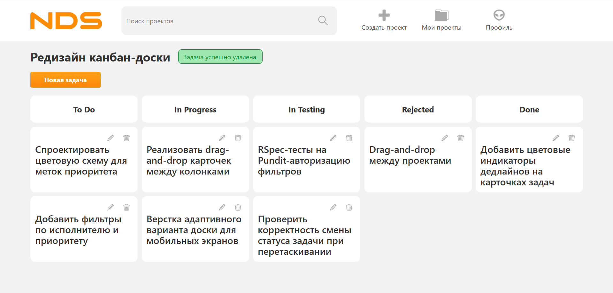

# Useful Practice

A web application for managing projects and tasks. Each user maintains their own projects with a kanban board of tasks organized by status.

## Stack

- **Ruby on Rails 8.1**
- **PostgreSQL**
- **Tailwind CSS 4**
- **Devise** — authentication
- **Pundit** — authorization
- **state_machines** — task status management
- **Hotwire (Turbo + Stimulus)**

## Features

- Sign up and sign in (Devise)
- Project CRUD — each project has a name, goal, and description
- Task CRUD within a project
- Kanban board with task statuses: **To Do → In Progress → In Testing → Done / Rejected**
- Project search by name
- Authorization via Pundit — users can only see and manage their own data

## Local Setup

**Requirements:** Ruby 3.3.12, PostgreSQL

```bash
git clone <repo>
cd useful_practice

bundle install

bin/rails db:create db:migrate

bin/dev
```

The app will be available at `http://localhost:3000`.

## Screenshots

**Authentication**


**My Projects**


**Project Search**


**Kanban Board**


## Tests

```bash
bundle exec rspec
```

**Stack:** RSpec + FactoryBot + FFaker + DatabaseCleaner + `rails-controller-testing`. 100 examples total.

### Model specs (`spec/models/`)

**`task_spec.rb`**
- Validations: valid creation, blank name is invalid, name must be unique within a project, same name is allowed across different projects
- Associations: `belongs_to :project`
- State machine — all 6 transitions tested individually:
  - `ToDo → InProgress` (inprogress)
  - `InProgress → InTesting` (intesting)
  - `InProgress → ToDo` (todo)
  - `InTesting → Done` (done)
  - `InTesting → Rejected` (rejected)
  - `Rejected → InProgress` (inprogress)

**`project_spec.rb`**
- Validations: valid creation, blank name is invalid, name must be unique per user, same name is allowed for different users
- Associations: `belongs_to :user`; `dependent: :destroy` removes tasks when project is destroyed
- `#tasks_by_state`: returns `[]` for a project with no tasks; interleaves tasks by kanban column; inserts `nil` for empty columns so the grid stays rectangular

**`user_spec.rb`**
- Validations: email required, email must be unique, password required
- Associations: `dependent: :destroy` removes projects when user is destroyed

### Controller specs (`spec/controllers/`)

Each action is tested against three scenarios:
1. Resource does not exist → renders 404
2. Resource belongs to another user → `redirect_to root_path` (Pundit)
3. Resource belongs to current user → normal behavior

**`projects_controller_spec.rb`** — all 6 CRUD actions:
- `GET #index` — redirects when not signed in; scopes projects to current user; filters by name search query
- `GET #new` — redirects when not signed in; renders form when signed in
- `POST #create` — blank name re-renders `:new` without creating a record; duplicate name re-renders `:new`; valid params create the project and redirect
- `GET #show` / `GET #edit` — authorization checks
- `PATCH #update` — updates the record; blank name re-renders `:edit`
- `DELETE #destroy` — deletes own project; does not delete another user's project

**`tasks_controller_spec.rb`** — all 5 actions (no `show`):
- Project lookup uses `policy_scope`, so a foreign project returns 404 (not a redirect)
- `POST #create` — blank name re-renders `:new`; valid params create the task
- `PATCH #update` — name and state updated separately in assertions; `state: nil` re-renders `:edit`
- `DELETE #destroy` — deletes the task; returns 404 for non-existent task

**`users_controller_spec.rb`**
- `GET #index` — redirects when not signed in; renders index template when signed in

### Policy specs (`spec/policies/`)

**`project_policy_spec.rb`**
- `index?` / `create?` — always allowed for any authenticated user
- `show?` / `edit?` / `update?` / `destroy?` — allowed for the owner, denied for a non-owner
- `Scope#resolve` — returns only projects belonging to the current user

**`task_policy_spec.rb`**
- All four actions (`show?`, `create?`, `update?`, `destroy?`) — allowed when the current user owns the task's project, denied otherwise

**`user_policy_spec.rb`**
- `index?` — always allowed for any authenticated user

